<!-- Header -->
<p align="center">
  
</p>

<p align="center">
  <a href="https://github.com/OmarRodriguezLopez1398">
    
  </a>
</p>

<p align="center">
  
  
  
</p>

<p align="center">
  
  
  
</p>

---

## 🧪 About me


```python
class Omar:
    based_in   = "Santiago de Compostela, Spain 🇪🇸"
    field      = "Physical & Computational Chemistry @ USC"
    working_on = ["Automated reaction discovery ⚡",
                  "Δ-learning corrections for QM 🤖",
                  "ML interatomic potentials 🧠"]
    fuel       = "☕ coffee"
    motto      = "If it works… definitely my fault 😎"
```

- ⚛️ **Automated reaction discovery**: finding mechanisms and transition states with molecular dynamics, graph theory and kinetics.
- 🤖 **Δ-learning corrections**: pushing fast semi-empirical methods (GFN2-xTB, PM6…) toward DFT accuracy for **barrier heights** and **reaction enthalpies**.
- 🧠 **ML interatomic potentials**: plugging **MACE** and **UMA** into reaction exploration workflows.
- 📚 **Teaching**: notebooks that show, step by step, how ML can be applied to chemical reactions.

<br clear="right"/>

---

## 🚀 Featured projects

<table>
  <tr>
    <td width="50%" valign="top">
      <h3>⚡ <a href="https://github.com/OmarRodriguezLopez1398/AutoMeKin-X">AutoMeKin-X</a></h3>
      Next-generation development version of <b>AutoMeKin</b>, a program that discovers reaction mechanisms automatically from a single XYZ structure. Supports MOPAC, Gaussian, ORCA, Qcore and <b>ML interatomic potentials</b> (MACE, UMA) via ASE + Sella.
      <br/><br/>
      
      
      
    </td>
    <td width="50%" valign="top">
      <h3>🤖 <a href="https://github.com/OmarRodriguezLopez1398/ML_Corrections_Reactions_Training">ML Corrections for Reactions</a></h3>
      Training materials and a hands-on Colab notebook: prepare reaction datasets, visualize R → TS → P pathways, train ML models on DFT energies and apply <b>Δ-learning</b> on top of GFN2-xTB.
      <br/><br/>
      
      <a href="https://colab.research.google.com/github/OmarRodriguezLopez1398/ML_Corrections_Reactions_Training/blob/main/Tutorial.ipynb"></a>
    </td>
  </tr>
  <tr>
    <td width="50%" valign="top">
      <h3>🕸️ <a href="https://github.com/OmarRodriguezLopez1398/amk_tools_X">amk_tools_X</a></h3>
      Tools to read, process and <b>visualize reaction networks</b> generated by AutoMeKin: NetworkX graphs, energy profiles and interactive Bokeh + JSmol dashboards.
      <br/><br/>
      
      
      
    </td>
    <td width="50%" valign="top">
      <h3>🧬 <a href="https://github.com/OmarRodriguezLopez1398/mopac_fgc">mopac_fgc</a></h3>
      MOPAC wrapper implementing <b>PM6-FGC</b>, a semi-empirical method that augments PM6 with functional group corrections.
      <br/><br/>
      
      
    </td>
  </tr>
</table>

---

## 🛠️ Tech stack

**Languages & tools**

<p>
  
</p>

<p>
  
  
  
  
</p>

**Computational chemistry**

<p>
  
  
  
  
  
  
</p>

---

## 📊 GitHub stats

<p align="center">
  
  
</p>

---

## 🔁 What I do here

```python
while True:
    build()
    break_things()
    fix_them()   # if it works... definitely my fault 😎
```

---

## 📫 Let's connect

Interested in reaction discovery, ML for chemistry or just want to talk molecules? Open an issue on any repo or reach out! 🤝

<p align="center">
  
</p>
